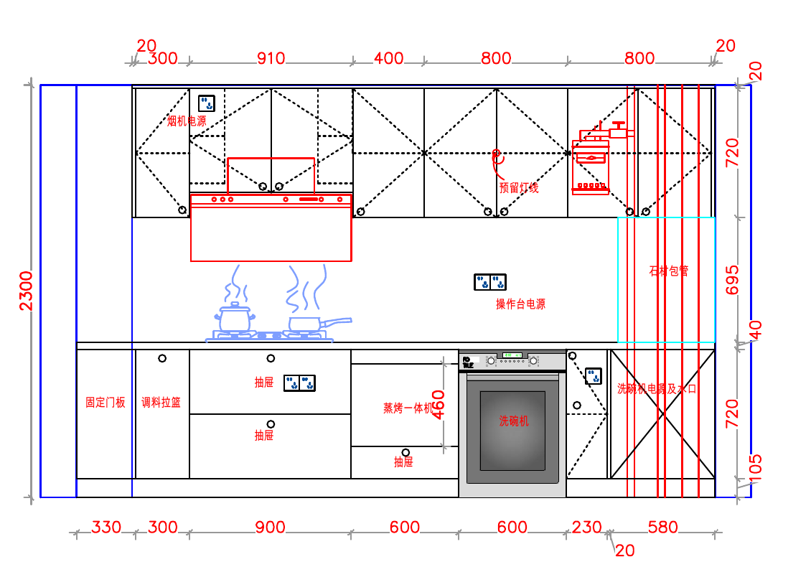
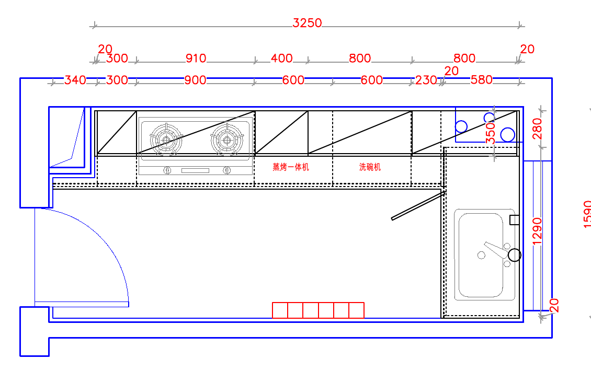
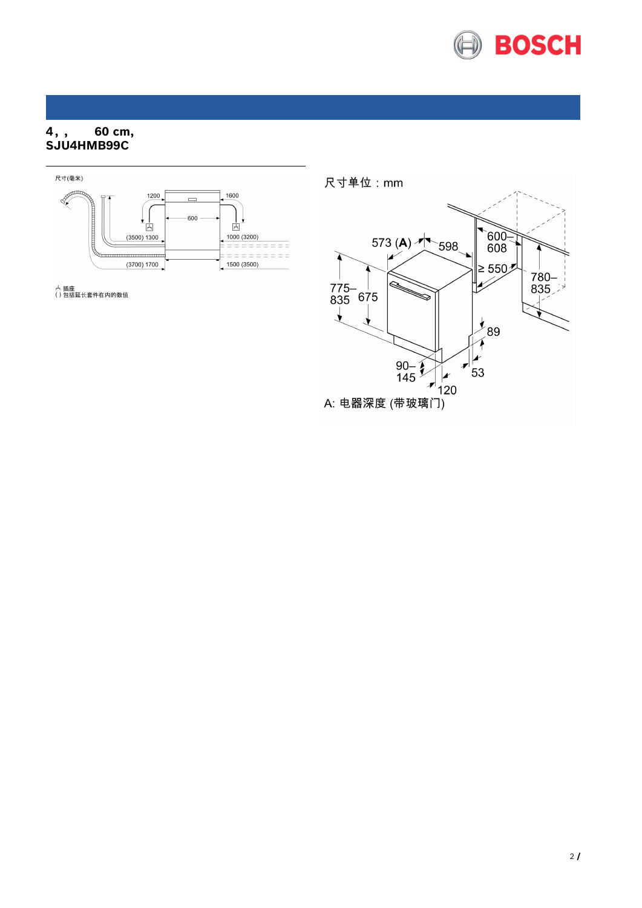
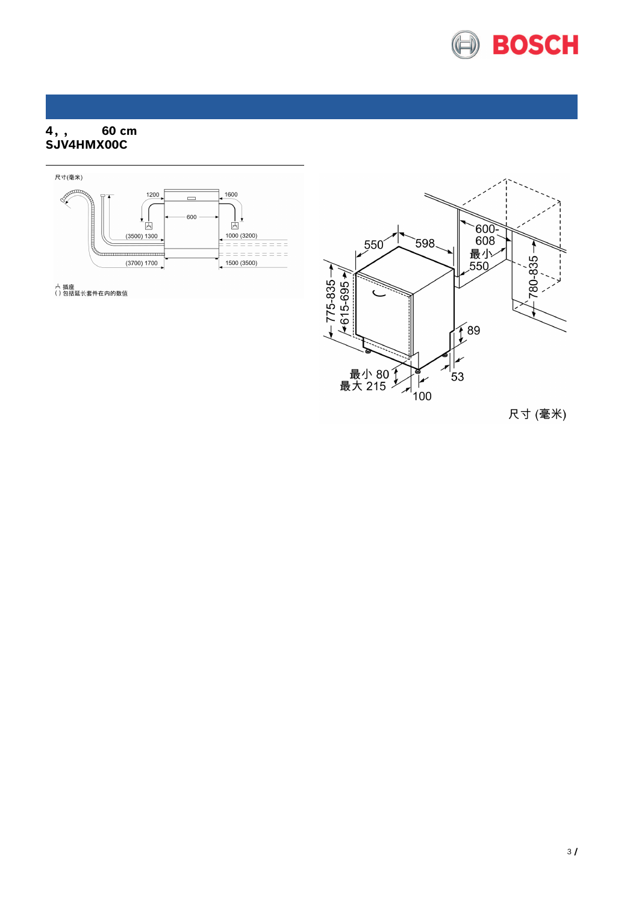
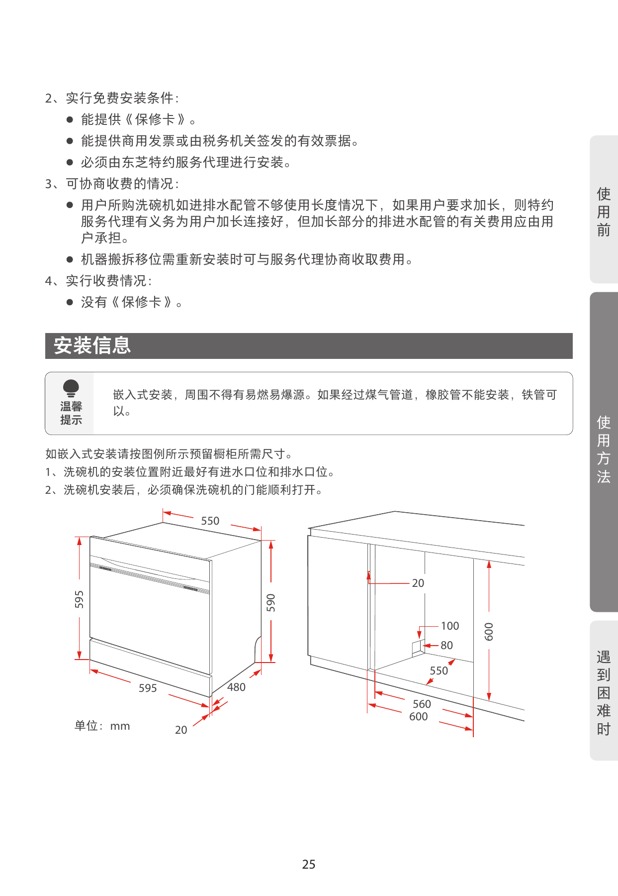
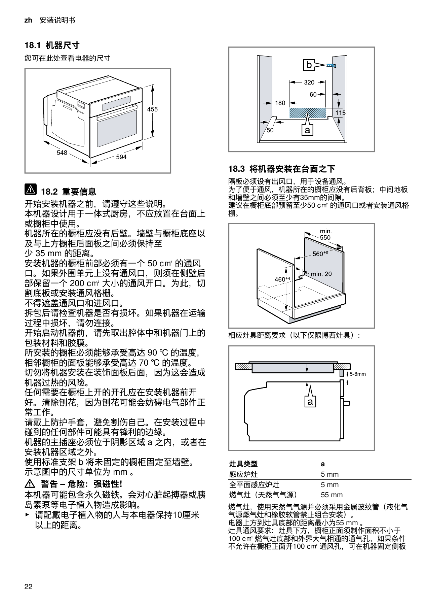
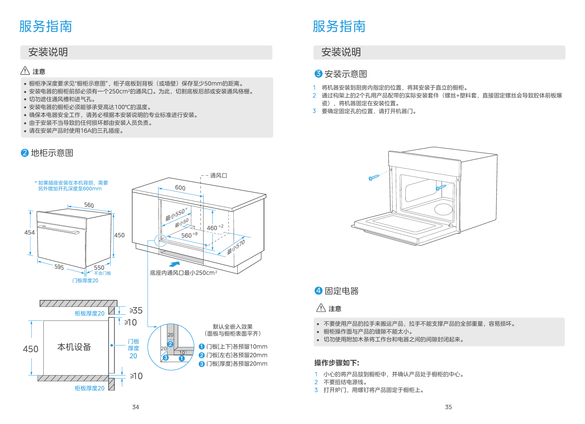
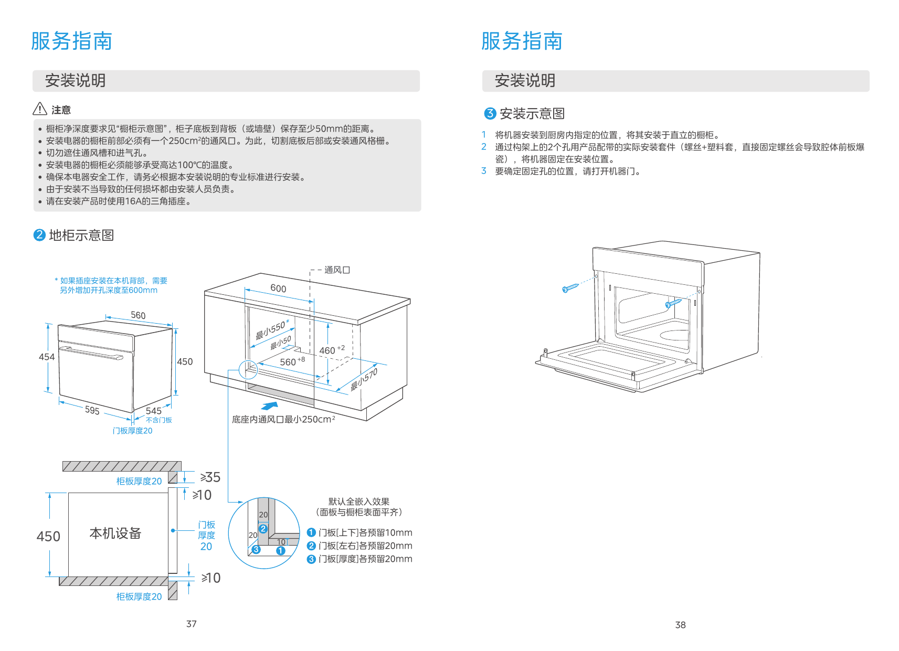

# 北京厨房三件电器初筛与冰箱历史核对

日期：2026年10月22日。范围：洗碗机、嵌入式蒸烤一体机、冰箱；京东中国候选与厂家安装资料。

当前按用户补充的交接文件和博洛尼橱柜确认图继续筛选：冰箱限定博世/西门子约500L、宽850×深600×高1935mm，强烈偏好自动制冰；用户进一步确认两处600mm是安装净口宽度：洗碗机为独立600mm净宽位，蒸烤机为600mm净宽、图示460mm高度并保留下抽屉。三类的最终净空、通风和型号安装要求仍须逐项闭合，尚无现场适配验收。

冰箱的8款主候选、京东页面实读和价格条件单列于[博西冰箱850柜位复核](北京博西冰箱850柜位复核_制冰与非制冰_2026-10-22.md)。此前卡萨帝、松下、美的冰箱线索不再作为当前主选。

## 1 冰箱讨论发生在什么时候

已找回原始 ChatGPT 会话 [fridge selection](https://chatgpt.com/c/6abbec5c-d410-83ea-b696-63857a67e803)，北京时间2026年9月30日08:51用户明确制冰强需求，09:05明确850×600×1935并要求分制冰/不制冰两组；10月1日09:53请求整理进京东清单。交接文件于10月22日20:44请求生成。具体型号讨论至少可追溯到9月30日，不能再将10月16日的装修进度同步当作首次选型。

10月16日23:29左右，在 [Plan next home refurbishment steps](codex://threads/01a00e5b-435f-7011-bba0-76a638d5a343) 中，用户另说尺寸已定、具体型号还没定，准备双十一采购。这是后续状态，未产生购买或最终型号结论。

## 2 最新橱柜图与尺寸条件

当前厨房尺寸来源改为用户新提供的[橱柜确认图PDF](../../references/厨电选型_2026-10-22/张帅-曹川北太平路橱柜确认图纸.pdf)，共3页；已逐页查看。它比P-06全屋平面更直接地描述洗碗机和蒸烤机位置。冰箱条件来自用户交接文件及原始发言，不由厨房图推定。

| 电器或结构 | 图纸/用户明确值 | 能据此判断的范围 |
|---|---|---|
| 冰箱 | 850宽×600深×1935高mm | 当前设计条件，不能换成1950高；仍按准确型号厂家图确认完工净空与开门 |
| 蒸烤一体机 | 用户确认600mm是安装净口宽度；第2页标460mm安装区高度，下有抽屉 | 三款候选安装图要求560–568mm净宽；现有600mm净口偏宽，需要按选定型号调整固定侧衬/安装框，不能直接判宽度适配 |
| 洗碗机 | 用户确认独立600mm为安装净口宽度；在蒸烤机右侧、水槽左侧 | **不在燃气灶下方**。SJU4HMB99C和SJV4HMX00C要求600–608mm，宽度条件满足；继续核净高、净深及门板/踢脚 |
| 地柜与踢脚 | 第2页标地柜720、踢脚105mm，上方另标台面结构40mm | 若洗碗机直接落地且无底板/横撑阻挡，地面至台面下沿可算约825mm；这是条件推算，不是实测净高。不能把720mm柜身高度误当洗碗机总安装高度 |
| 深度与背板 | 三页未明确标出两台机器各自可用净深及板厚 | 不能因为常见橱柜深600就直接给本位600mm净深；图中管道处350等局部尺寸不代作机器净深 |
| 水电 | 第2页洗碗机电源/水口画在右侧相邻柜；第3页水槽下列软水、净水、垃圾处理器等设备 | 便于沿相邻柜布管；仍要核高度、长度和检修。蒸烤机专用插座、16A及散热构造未由现图确认 |

图纸台面材料说明写15mm石英石，立面尺寸链写40mm台面结构；两者不是同一口径，不把40mm任意再从已经推算的台面下沿高度扣一次。柜厂应标注最终安装完成面的直接净尺寸。

旧[施工图P-06](../../references/北太平路施工图（实际）-施工图.pdf)的约900×600冰箱平面占位仅为早期线索，不再支配冰箱筛选。洗烘柜600/610mm深度也不自动适用于厨房。

## 3 洗碗机首轮候选

### 按新柜图优先核对的标准高度款

| 准确型号 | 容量及面板路线 | 厂家安装图尺寸，单位mm | 与本户条件的关系 | 京东入口 |
|---|---|---|---|---|
| **博世 SJU4HMB99C** | 20套型号；自带黑色玻璃面板路线 | 官方规格书第2页：机宽598、高可调775–835、含玻璃门深573；净开口宽600–608、高780–835、深≥550；图示踢脚90–145。 | 若本位实测净高约825，处于安装范围；图纸踢脚105也处于图示范围。已确认600mm净宽满足600–608mm要求；仍需核净深≥550和门板/踢脚动态关系，不保证玻璃面与周围柜门已齐平。 | [10174664882256](https://item.m.jd.com/product/10174664882256.html)，京东博世家电官方旗舰店线索；北京实价/配送待核 |
| **博世 SJV4HMX00C** | 16套全嵌路线；需另配橱柜门板 | 官方规格书第3页：机宽598、高可调775–835、深550；净开口宽600–608、高780–835、深≥550；图示踢脚80–215，装饰门板高度范围615–695。 | 高度同样可继续核。**不能把图纸720mm柜身直接做成720mm整块机器门板**；应按门板范围、固定结构和踢脚开门路径重新深化。600mm净宽满足要求；净深仍待确认。 | [10174984482587](https://item.m.jd.com/product/10174984482587.html)，京东博世家电官方旗舰店线索；北京实价/配送待核 |

两款都有准确型号的厂家安装尺寸图，比此前只找到使用手册的型号更便于核柜。当前优先看SJU4HMB99C自带面板方案；若希望与橱柜门板一体，再看SJV4HMX00C并单独核门板。不能把“官方旗舰店”误写成“京东自营”，也未将非北京地址的页面报价当成本户价格。

一手图：[SJU4HMB99C中文规格书](https://media3.bsh-group.com/Documents/specsheet/zh-CN/SJU4HMB99C.pdf)、[SJV4HMX00C中文规格书](https://media3.bsh-group.com/Documents/specsheet/zh-CN/SJV4HMX00C.pdf)，本地原件与图像均已归档。最终还需该销售版本安装说明中的固定、排水、防潮和门板细则。

### 先前紧凑型及其他备选

| 型号 | 已确认的特点 | 安装判断与缺口 | 京东入口 |
|---|---|---|---|
| **西门子 SE45ZB25KC** | 京东列15套、灶下型；准确型号官方使用手册确认晶蕾烘干、96至240小时晶蕾储存及蒸汽预洗等功能。 | 这是矮型灶下设计线索；本户实际为独立柜位，不再优先采用。官方使用手册将开孔尺寸指向另附安装说明；本轮未取得该独立图。需核完整安装图、独立柜位承托和收口，不把矮机型当作825mm落地位的直接替代。 | [商品100172162471](https://item.jd.com/100172162471.html) |
| **东芝 DWTQ5W-1327 白玉TQ5W** | 准确型号官方手册：13套，1380W，9.7L/周期，0.800kWh/周期，一级水效；参数表外形595×595×500mm。 | 手册印刷页25有安装图：机身正面宽595、高595；上部纵深另标550，底部480及前面20；柜图标高600、深550，并同时标560与600两层宽度及20mm覆盖关系。**按完整图确认嵌装结构，不能只拿500mm参数下结论。** | [商品10126330024308](https://item.jd.com/10126330024308.html) |
| **博世 SMS4EKB88C 小虎鲸 Solo** | 京东可检索准确型号，17+3容量及自动开门烘为商品目录宣传。 | 暂缓适配推荐。未取得型号匹配官方安装图；京东导购同时给出的机身600深和柜位550深等数字存在冲突，已舍弃。不能用来下单或开柜。 | [商品10205047214576](https://item.jd.com/10205047214576.html) |

西门子SE45和东芝TQ5W先保留为矮型备选。新图显示独立洗碗机柜位，若约825mm落地净高成立，应优先核上表标准高度款，再结合实际锅具和碗篮比较。套数不等于能放下家里的炒锅。美诺 G 521 的完整后缀及中国安装资料未匹配，方太水槽式又涉及台面和水槽重设计，暂不进入推荐前列。

东芝手册安装图已逐图核对，560/600不能任选一个数字套用：

一手资料：[西门子准确型号使用手册](https://media3.bsh-group.cn/Documents/9001821787_A.pdf)、[东芝准确型号完整手册](https://dsdcp.smartmidea.net/mcsp/prod/20240719/2f8cf1bc1fec4677b5951f4a3b016276.pdf)。西门子手册要求根据实际水硬度设置软水系统；北京使用也应以本户实际进水和是否有全屋软水为准，不能按城市名称直接设置盐量。

## 4 蒸烤一体机首轮候选

以下三款均为约45cm高度级嵌入设备，容量大不代表需要60cm高开口。尺寸按宽×高×深列出。

| 型号 | 容量与功能 | 外形及安装图重点 | 京东入口 |
|---|---|---|---|
| **西门子 CS289ABS6W** | 45L，独立蒸制及烤制；不是仅喷汽辅助烤。官方规格功率2900W。 | 规格页约595×455×548；手册机图宽594。台下开口宽560+8、高460+4、深≥550mm；无后背板，柜底与墙留≥35mm通风空间，柜前50cm²通风口，特定无外围通风情况下需侧后部200cm²。 | [准确型号目录](https://www.jd.com/cppf/7375dd224412e51b1ff.html)，单一SKU待核 |
| **美的 SX5，产品型号 TQN50E-TSBC00** | 55L；纯蒸、高温蒸、上下管及热风烤、空气炸；不带微波。 | 官网约595×454×568；对应SX5安装图开口宽560+8、高460+2mm，图中同时有最小550/570mm深度标注，需厂家解释测量起终点。背部插座方案需600mm开孔深度。3200W、16A插座；后部/柜底50mm及柜前250cm²通风按完整图落实。 | [商品100088782955](https://item.jd.com/100088782955.html) |
| **美的 GC5** | 55L，微波、蒸、烤复合；希望省掉独立微波炉时优先比较。 | 约595×454×565；手册地柜安装图宽560+8、高460+2mm，并同时标最小550/570mm深度基准；背部插座需600mm深度。3200W、16A；背部及底座通风结构按手册落实。 | [商品100068784671](https://item.jd.com/100068784671.html) |

**选择顺序：** 先确定是否保留独立微波炉；不需要微波时比较西门子CS289与美的SX5，需要微波时增加GC5。方太 ZKW45-G5P 可作备选：官网45L、595×455×556、半嵌开孔560×450×≥550mm，2950W；“微烹饪”名称本身不能证明有微波功能，本轮不据此替代微波炉。

当前确认图的蒸烤机在灶具右侧独立柜位，非灶下组合。重点转为下抽屉承托/隔板、柜后通风和专用插座。西门子手册的灶下规则只有位置变更时才适用。

三款地柜开口名义高度均为460mm级，与新图方向相符，保留为需调整安装口的候选。**用户已确认现有600mm为净口宽度，因此这三款不能按原口直接判定适配**：厂家要求560+8mm，即560–568mm净宽，而机器前面板仅约594/595mm。柜厂需按选定型号加装可牢固固定的侧衬或重做安装框，将有效净宽调整至厂家范围，并保留机器固定点；总收窄约32–40mm，居中时每侧约16–20mm。美的地柜图同时给最小550/570mm不同深度基准和背插条件；在柜厂加工图中逐一标明测量终点。下抽屉不能挡住机底通风，不能用收口条封掉要求的间隙。

一手资料：[西门子规格书](https://media3.bsh-group.com/Documents/specsheet/zh-CN/CS289ABS6W.pdf)、[西门子使用及安装手册22至23页](https://media3.bsh-group.cn/Documents/8001211852_B.pdf)、[美的SX5官网](https://www.midea.cn/154/1000000000400742660952.html)、[SX5准确手册](https://dsdcp.smartmidea.net/mcsp/prod/20240129/a06b4933aabc44ada8f1942716d14645.pdf)、[GC5手册](https://dsdcp.smartmidea.net/mcsp/prod/20240809/97868a6b2fea4db88eb18dfd4739ec41.pdf)、[方太G5P官网](https://www.fotile.com/product/13967.html)。不借用SX5 Pro的安装数据。

## 5 冰箱按博西8款重新核对

主记录见[北京博西冰箱850柜位复核](北京博西冰箱850柜位复核_制冰与非制冰_2026-10-22.md)。当前自动制冰组为KC89BV163C、KC89BVA63C、KCB89VA26C、KFB89VA21C；原不制冰基准组为KF88E1220C、KF89CE163C、KME50S97TI、KCP50A20TI，后组仍需按SKU明确制冰配置。

本轮已直接读到KC89BV163C及KFB89VA21C京东页面，两款均写产品842×594×1925、预留850×600×1930mm。页面条件价分别4776.44元、5596.84元，页面现有北京区域；未核本户补贴资格和最终实付，不能当作无条件报价。其余6款未得到同口径实价，暂不计算制冰配置包溢价。厂家完整安装图仍缺，不将这两款判作最终安装通过。

## 6 下一步需要锁定的信息

| 项目 | 所需输入 | 决定什么 |
|---|---|---|
| 冰箱柜 | 按已知850×600×1935继续；补厂家安装图及邻接墙/高柜、插座、开门条件 | 排除超宽超高机型，核90°/120°门和抽屉可取放；插头不顶住机器 |
| 洗碗机位 | 已知独立600mm安装净宽；补地面至台面下沿直接净高、净深、底板/横撑、踢脚和水电 | 优先标准落地嵌入路线；核门板与踢脚、实际管线占用 |
| 蒸烤机位 | 已知600mm安装净宽、图示460mm安装区和下抽屉；按型号调整有效净宽，补净深、后板/隔板通风、专用插座 | 匹配45cm安装图；落实16A和散热，不用产品外形替代开口 |
| 日常需求 | 冰箱制冰强需求已明确、无硬预算；洗碗/蒸烤预算、是否保留微波炉、主要锅具待补 | 缩小到每类2至3款，再做功能与价差比较 |
| 北京交付 | 京东北京实际收货区、准确销售SKU及销售方 | 实时实付价、库存、保修渠道、送装、改柜及上楼费用 |

拿到尺寸后，逐款标“可适配 / 需要改柜 / 排除 / 待厂家答复”，再做北京地址下的价格和服务核验。柜体制作只能采用最终完整型号及后缀的厂家安装图；不能依据此首轮表直接开孔。

## 7 资料与核验范围

- 已核对原始ChatGPT冰箱会话及关键发言时间；未声称完整检索所有历史。
- 已阅读图纸P-06及关键厂家手册，逐图检查松下E531、东芝TQ5W、西门子CS289、美的508安装图；图像归档见[来源说明](../../references/厨电选型_2026-10-22/README.md)。
- 冰箱两款已读取准确京东商品页和页面北京区域条件价，其余型号仍有目录/详情页缺口；京东展示、账号最终实付与厂家适配分别记录。
- 已读最新橱柜确认图和冰箱交接文件；600mm安装净宽已由用户确认；剩余是蒸烤机净口调整、两台机器净深、洗碗机净高及通风构造。现场测量、厂家审核、搬运入户及安装未验收。
