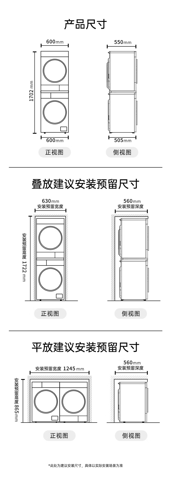
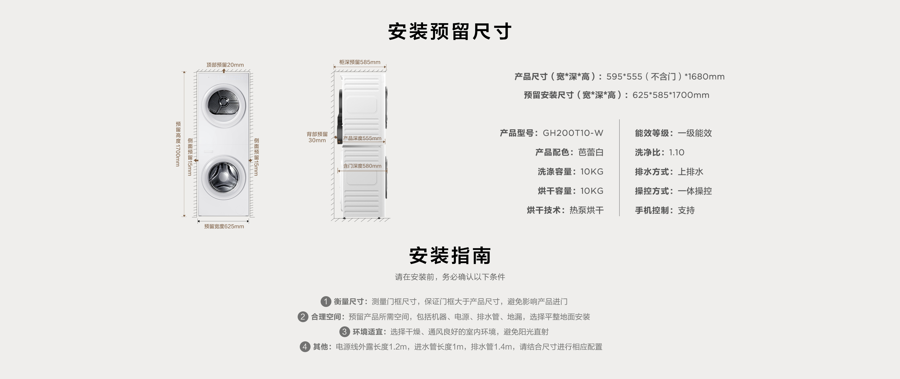
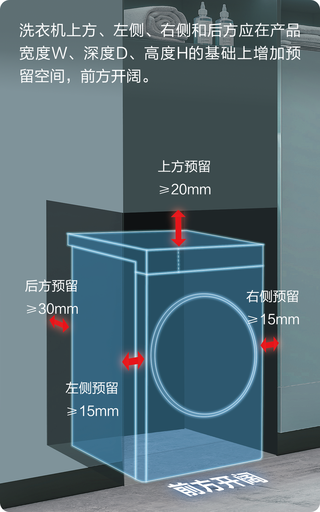
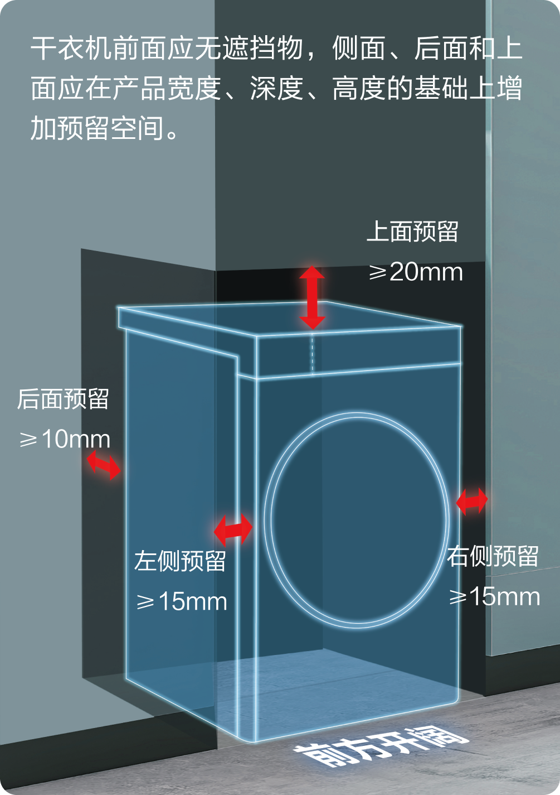

# 北京洗衣机＋热泵烘干机：600mm柜深、允许机门突出10mm

检索日期：2026年10月22日。最终条件按用户更正后的 **1cm**，不是10cm。

**状态：调研候选，未完成成套安装确认；不是下单或柜体定稿依据。** 价格、补贴和库存均为当日所见，后续使用时需刷新。A/B/C是空间筛选分档，不是品质排名。

[原始证据目录](../../references/洗烘套装选型_2026-10-22/README.md) · [用户提供的柜体尺寸图](../../references/洗烘套装选型_2026-10-22/定制柜尺寸-用户提供.jpg)

## 结论与条件

- A档：后墙到关门后的最前端，连同必需管线和安装间隙，≤600mm。
- B档：同一口径≤610mm。柜体仍按600mm，允许前端突出10mm。
- 图纸初读：净宽约630mm，总高2200mm，上柜450mm，所以设备区约1750mm；须核实450是否已含板厚、630是否确为完成面净宽。叠放支架、调平脚、顶部散热空间均要算入。
- 不能拿“机身深度”“顶板深度”“适配600柜体”直接替代安装总深。这里保留了这些尺寸的原始口径。
- 本轮覆盖19个品牌，结合京东实际搜索和商品页、京东目录索引、厂家原始参数/安装图/说明书。不同来源的证据等级分开标注。这是较广的候选普查，**不等于已经查全所有在售SKU，也不等于每款都确认了北京库存**。
- 严格A档目前没有找到资料足够完整、又能直接确认北京可买的成套方案。B档TCL T10有610mm原图计算依据，海尔75DW两台精确说明书支持保守按607mm核对；前者所查白色京东自营SKU在北京暂时售完，后者尚未确认可买SKU及叠架高度。松下M2是目前最值得优先核实的可购候选。

## 优先保留的候选

| 优先次序 | 精确型号 | 已核到的关键尺寸 | A600 / B610判断 | 京东和北京状态 |
|---|---|---|---|---|
| 1 | 松下 XQG100-M2Q1＋NH-M2QR1，10＋10kg | 两机宽600；叠放本体高1702；商品专属图建议开口 **宽630×深560×高1722**。洗衣机深505、烘干机深550均明确“不含机门” | A、B均保留候选；还不能用560证明含门含管线的总深。630净宽恰好等于专属建议，无余量 | [京东自营商品页](https://item.jd.com/100215421700.html)。实际页面所查北京区域可配送；显示补贴价约¥10,642.75，含资格/券条件，最终以结算为准 |
| 2 | TCL GH200T10-W 双子舱T10，10＋10kg热泵双筒塔 | 宽595×高1680；不含门555，**含门580**；厂家后预留30；开口宽625×深585×高1700 | A不满足；**B纸面610正好达标**。前提是现场电源、进排水都能按原图收在30mm背部预留内 | [京东自营商品页](https://item.jd.com/100069014789.html)。实际北京页面显示“此商品暂时售完”；其他颜色/新型号不能套用此库存或尺寸 |
| 3 | 东芝玉兔2.0 DG-10T19BI＋DH-10T19B，10＋10kg | 洗衣机说明书：最大深580、后留空30，即610；烘干机厂家图标安装深600。宽595、单机高850 | A洗衣机不满足；B边界候选。还缺整套支架后高度、烘干机完整含门/管线定义 | 京东目录可检索到精确套装，但尚未确认当前北京可下单的正常自营SKU；厂家商城页面已下架，不应按旧活动价推荐购买 |
| 4 | 海尔云溪4.0Pro XQG100-BLEG75DWU1＋GA100-STQ75DWU1，10＋10kg | 厂家洗衣机宽595×高850×深556；烘干机宽595×高850×深577，顶板深558 | B档重点候选；577不是安装总深。原厂H5已核：洗衣机后≥30、烘干机后≥10、左右各≥15、上≥20。保守两机背部都留30，最大577＋30＝607，B有尺寸依据；A需两机前后错位及叠架允许，暂不确认；支架后的总高仍需确认 | [京东75DW目录线索](https://www.jd.com/jiage/73763cfab7fc13ceb2e.html)有75DW＋75DW；搜索索引曾出现此组合，但新打开目录会返回其他型号；尚未锁定有效商品SKU、商家及北京配送 |
| 备选 | 海尔 XQG100-BLEG582HU1＋GA100-STQ582HU1 | 厂家外形深560／580，单机宽595、高850 | A背部仅余20，B余30；582精确型号仍缺安装留空及支架证据，不能套用75DW说明书 | [京东套装线索](https://item.jd.com/10164825802935.html)，未核北京现货/自营，优先级低于75DW |

松下M2F1＋M2NR1也检索到[京东页面](https://item.jd.com/100215421656.html)，但它是另一套型号，不能直接套用M2Q1的银离子功能、价格和安装尺寸。

## 最关键的原始证据

### 松下M2：柜口图很有希望，但门深定义仍需确认

[京东原始商品尺寸图](https://img30.360buyimg.com/sku/jfs/t1/490425/6/12976/33465/6a7ae310F7dbfc272/00d631629613cd02.jpg.avif)明确写“不含机门”。[京东原始叠放图](https://img30.360buyimg.com/sku/jfs/t1/490963/15/11061/88550/6a7ae317Ff922232d/00d63168bdb1bc02.jpg.avif)写630×560×1722，但未明确560就是后墙至关闭机门最外端、并含全部接头。

同页另有通用安装须知，写侧面各20mm、背后50mm、上方30mm，和专属630宽开口存在口径差异（600＋20＋20＝640）。所以应让厂家按这两个精确型号确认专属图是否优先，以及现场到底需要多少。不能只凭通用规则宣布它一定不行，也不能忽略冲突宣布一定能装。

### TCL T10：可以真正算出610mm

[厂家T10页面](https://www.tcl.com/cn/zh/washing-machine/t10)的安装图同时给出555不含门、580含门、后预留30。因此580＋30＝610；其开口625宽和1700高均小于图纸初读630宽、约1750高。

这是双筒、热泵烘干的洗烘塔，不是单筒洗烘一体机。尺寸合适仍受当前北京缺货限制。TCL P10的厂家图也给含门580、开口630×585×1700，但未找到足够可靠的正常在售京东SKU，故不作为确定可买的推荐。

### 东芝T19：只保留B档，不把旧款对比图误算到新机

[厂家精确套装页面](https://www.midea.cn/395/1000000000400701586424.html)、[洗衣机说明书](https://dsdcp.smartmidea.net/mcsp/prod/20231008/37b0d035bf7441c195a2161981e7165f.pdf)、[烘干机页面](https://www.midea.cn/59/1000000000400701806524.html)。洗衣机最大580＋背部30＝610。烘干机对比图左边旧款“突出30mm”，右边新款标“安装深度600mm”；不能把旧机的30mm加到新机上，也不能由一张营销图证明全部管线条件。

### 海尔75DW：新核得两台精确型号的H5原厂说明书

[洗衣机说明书](https://washerh5.haier.net/washShare/ies/CEAEFW000/D/web/index.html)明确XQG100-BLEG75DWU1：D1关门外廓556，后预留≥30，左右各≥15，上方≥20mm。[烘干机说明书](https://washerh5.haier.net/washShare/ies/CF0J0C000/C/web/index.html)明确GA100-STQ75DWU1：D1含门577，后预留≥10，左右各≥15，上方≥20mm。

若两机背部均保守留30mm，则最深的烘干机为577＋30＝607mm，适合B档的深度条件，只有3mm余量。净宽至少595＋15＋15＝625，630柜口只余5mm。两台裸机合计高1700，再加顶部20后1720，按约1750开口，留给叠架/调平变化的空间约30mm。最终须取得原配叠架后的准确尺寸；现场凸出的插座、水龙头不能侵占这3mm余量。

单独计算最小安装深度，洗衣机556＋30＝586，烘干机577＋10＝587，但这需要两机前后位置及支架允许，因此不能直接宣布整套A档587mm。A档暂不作确定结论。

## 19品牌覆盖与排除记录

以下判断针对列出的具体型号，不扩大为“该品牌所有产品都不合适”。“待证”表示未取得足够安装证据，不表示已证明超尺寸。

| 品牌 | 本轮代表型号/系列 | 关键发现与处理 | 主要链接 |
|---|---|---|---|
| 博世 | WWJ752Y10W＋WTJ752Y11W；另查752Y00、552Y00超薄系列 | 洗衣机565是名义机身深度，原厂侧视图最大外廓610；尚未另计现场后留空。A不满足，B没有直接确认条件 | [京东](https://item.jd.com/100391506596.html) · [原厂尺寸PDF](https://media3.bosch-home.com/Documents/specsheet/zh-CN/WWJ752Y10W.pdf) |
| 西门子 | WW52J7I80W＋WT52J7Y81W；另查J7Y00、小晶钻H1U00 | 已核J7I80图同样565名义/610外廓；不能直接当610安装总深。其他精确型号未取得不同的安装证据 | [京东](https://item.jd.com/10216654148169.html) · [J7I80尺寸PDF](https://media3.bosch-home.com/Documents/specsheet/zh-CN/WW52J7I80W.pdf) |
| 松下 | M2Q1＋M2QR1；M2F1＋M2NR1 | 前者是优先候选，后者独立待核 | 见上文 |
| 东芝 | T19；另查T186B | T19为B边界候选；T186B缺精确安装图 | [T186B京东线索](https://item.jd.com/100246010647.html) |
| 海尔 | 75DW、582、65D、云溪5.0 | 75DW已有精确H5含门和安装间隙，B档有607mm依据；65D的10kg烘干机深580，但不可把12kg京东套装与10kg官网参数拼接。各套叠架高度仍需核 | [75DW洗衣机](https://www.haier.com/laundry/20250902_270500.shtml) · [75DW烘干机](https://www.haier.com/laundry/20250918_271792.shtml) · [65D烘干机](https://www.haier.com/laundry/20250812_269897.shtml) |
| TCL | T10、P10、H100P5-B | T10纸面B610但北京所查SKU缺货；其余无可完成验证的精确在售组合 | [T10](https://www.tcl.com/cn/zh/washing-machine/t10) · [P10](https://www.tcl.com/cn/zh/washing-machine/gh200p10) |
| 美的 | MGH20AIR-W清风明月2.0 | 说明书最大深600、后至少30，约630，A/B均不满足 | [京东](https://item.jd.com/10136052588637.html) · [原厂说明书](https://dsdcp.smartmidea.net/mcsp/prod/20250110/77ff6caad54445de80b397a3aed40a90.pdf) |
| 小天鹅 | TG10VE40＋TH10VE40；另查小乌梅5.0 | VE40洗衣机最大582、后30，已612，B也超2mm；5.0尚缺精确安装证据，不能整品牌排除 | [京东VE40](https://item.jd.com/10147605051021.html) · [洗衣机说明书](https://dsdcp.smartmidea.net/mcsp/prod/20250321/da045930008e488abd4a3bfbb7bcbba0.pdf) |
| COLMO | CGU10H-C3＋CHZ10H-C3 | 标称565/585，缺C3精确最大外廓和后留空；不能套C2说明书，待证 | [京东](https://item.jd.com/100187721544.html) |
| 卡萨帝 | CE B10LWUBWCU1＋CG S10BUBWCU1揽光Pro | 官方外形深594/603；B烘干机后仅余7mm，未证明可安装。没有据此排除其他揽光型号 | [洗衣机](https://www.casarte.com/laundry/20250925_280162.shtml) · [烘干机](https://www.casarte.com/laundry/20250923_271942.shtml) |
| 海信 | WF120E5S＋DH120E5S大薄荷2.0E5S | 官方商城套装595×590×1700，未说明590是否含门、后接头及间隙，待证 | [京东](https://item.jd.com/100331413888.html) · [厂家商城](https://mall.hisense.com/items/6863) |
| 米家 | XQG100MJ109＋H100MJ105蓝氧Pro | 官方522mm说明不能证明两机各自安装总深；未取得足够的成套尺寸证据，待证 | [京东](https://item.jd.com/100187946986.html) · [官网](https://www.mi.com/mijia-wash-dryers/oxygen-pro) |
| 石头 | XQG120RRC32＋RRF32 Z1Max | 没有取得精确型号的完整官方安装尺寸，待证；不采用互相冲突的第三方617/653数据判断 | [京东](https://item.jd.com/100164185353.html) · [官方目录](https://cn.roborock.com/product?type=washing-machine) |
| LG | FN23WQH WashTower；另查X5套装 | 塔式官方深660；DH10X5WB1烘干机也约660，明确超610 | [京东塔式](https://item.jd.com/100081212331.html) · [LG官网](https://www.lg.com/cn/washing-machines/lg-fn23wqh) |
| 三星 | WW12DB9B84GDSC＋DV11DB94A0GDSC | 标称550/580未解决含门与后留空；仅有机身值不足以判B，待证 | [京东](https://item.jd.com/10167917395100.html) · [中国官网套装](https://www.samsung.com.cn/washers-and-dryers/washing-machines/ww9400d-f-ww12b9dv11b9/) |
| 伊莱克斯 | EWF1024D3WB＋EDH803Q7WB | 洗衣机说明书深659，烘干机官方深638，超610 | [京东](https://item.jd.com/100234864685.html) · [烘干机官网](https://www.electrolux.com.cn/appliances/dryers/edh803q7wb/) |
| AEG | T859I6OB烘干机 | 官方深662，超610，不作为本柜候选 | [官方参数](https://www.aeg.cn/appliances/dryers/t859i6ob/) |
| Miele美诺 | WCD361＋TCD361 | 京东有目录；未取得中国精确361型号安装尺寸。近似360参数不能代替361，待证 | [京东目录](https://www.jd.com/jiage/737c94d6538e67719ec.html) |
| ASKO | WAU9W＋TAU9H；另查WAU9C/WAU10W组合 | 京东有具体SKU，没取得对应中国型号完整安装图，不将海外630参数当作精确中国型号结论 | [京东](https://item.jd.com/10219452687418.html) |

## 已完成及未完成的验证

已完成：京东实际搜索“洗烘套装 超薄”；直接打开松下M2与TCL T10商品页查看北京配送/缺货；提取并阅读京东M2原始尺寸图和安装图；交叉检查厂家参数、TCL含门/背部尺寸、海尔75DW两机H5原厂安装留空图及若干品牌原厂说明书。部分京东页面通过网页检索不能读取、浏览器访问也有超时，因此其他型号只标目录/商品线索，不标北京现货。

未完成：厂家书面或现场给出的“后墙—含门最前点”成套尺寸、现场管线位置、完整叠架高度、全部19品牌当前SKU逐一开页、实体安装验收。未购买、未联系商家。

## 给设计师或安装方的一句核对要求

“完成面净开口暂按宽630×高约1750×深600mm，正面允许门最外端最多突出10mm。请按精确的洗衣机、烘干机及原装叠架型号，确认后墙到关门最前端总深≤610mm，含水管接头、排水弯曲、电源插头和厂家散热留空；同时标注叠架后总高、顶部间隙及侧边间隙。请勿仅提供顶板/机身深度。”

## 补充：C档——博世／西门子最接近尺寸的优先备选

C档表示“待放宽深度的候选”，不是已满足600或610mm，也不是品质排名。用户尚未指定C档深度上限，不擅自把某个放宽值当作已接受条件。

| 选择 | 精确套装 | 已核洗衣机外廓 | 推荐理由及京东入口 |
|---|---|---|---|
| C1：西门子白色 | 小幸熨超薄 WW52J7Y00W＋WT52J7Y01W，10＋10kg热泵 | 宽598，高848（调脚另有+12），名义机身深565，原厂侧视最大610 | 京东目录明确标自营，有独立精确套装SKU；洗衣机原厂资料确认智能投放、蒸汽除皱。[京东商品页](https://item.jd.com/100248516603.html) |
| C2：博世灰色 | 摩德纳Slim WWJ752Y10W＋WTJ752Y11W，10＋10kg热泵 | 宽598，高848（调脚另有+12），名义机身深565，原厂侧视最大610 | 已有原厂精确尺寸图、京东超薄套装商品页，适合希望选择星云灰外观者。[京东商品页](https://item.jd.com/100391506596.html) |

两款已确认的洗衣机外廓相同，不能声称某一套更薄。配套烘干机的完整含门／管线外廓和原装叠架高度仍未取得足够资料，因此这里推荐的是优先核实对象。

**C档空间估算：**仅以已确认的洗衣机最大610mm为基准，若厂家/现场需要额外后留空r，则占深610＋r。r=20时630，r=30时640，r=50时660mm。对应600mm柜体，前端突出分别30、40、60mm，均超过原先允许的10mm。r尚未核实，640/660不是两型号原厂安装定值，也不能当整套最终占深。烘干机如需更多空间，还要按较大值。

630净宽减598机宽剩32mm，居中每侧16mm；是否满足厂家实际要求仍须确认。约1750mm高的开口也必须用原装叠架后的总高核对，不可只把两台裸机高度相加。

西门子注意买 **WW52J7Y00W**，不要与 **WG52J7Y00W** 混淆；博世注意 **WWJ752Y10W** 与 **WGJ752Y10W** 不同。不同前缀不能套用此处565/610尺寸。本次新打开西门子京东目录并取得具体自营套装SKU；浏览器商品页读取超时，因此不宣称已刷新这两套当前北京现货、配送日期或结算价格。

尺寸来源：[西门子原厂PDF](https://media3.bosch-home.com/Documents/specsheet/zh-CN/WW52J7Y00W.pdf)、[博世原厂PDF](https://media3.bosch-home.com/Documents/specsheet/zh-CN/WWJ752Y10W.pdf)。

## 本地归档与复查

本报告的关键图片、说明书和两台海尔75DW精确型号的H5数据已保存在[原始证据目录](../../references/洗烘套装选型_2026-10-22/README.md)，不依赖本机临时目录。来源、文件口径和校验方式见目录说明。公开商品链接仍可能改变、失效或切换默认型号；没有据此补写未确认的库存或尺寸。
