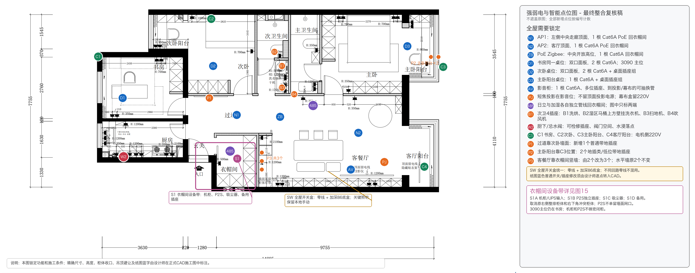
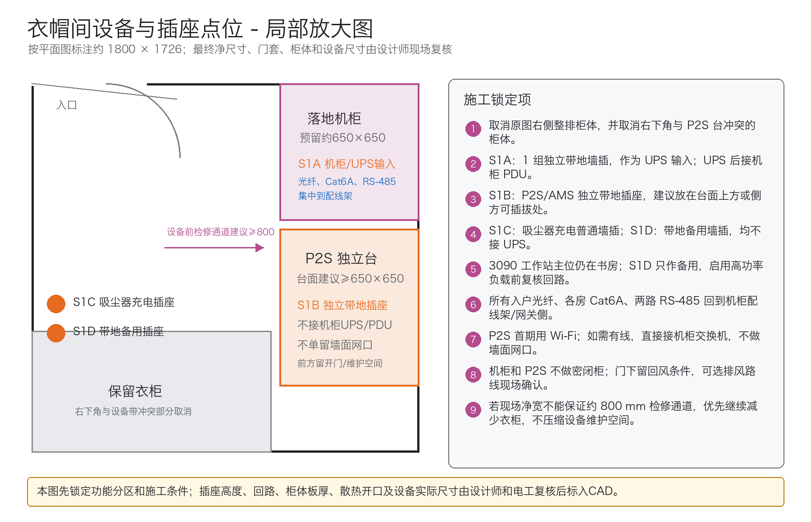

# 点位图最终整合复核（2026-07-14）

本轮以设计师黑色强弱电图和纸质红蓝手改图为依据，只补充影响装修施工的智能、网络、固定设备和衣帽间设备点位。

[下载可编辑 PowerPoint 点位图](../../exports/强弱电与智能点位图_可编辑版_2026-07-15.pptx)：黑色设计师底图作为背景，彩色点位、插座组、文字说明和衣帽间设备框均可单独拖动修改。

## 复核结论

1. 四组窗帘电源已转入 `C1-C4`：`C1` 书房、`C2` 次卧、`C3` 主卧阳台、`C4` 客厅阳台；每组单层电动窗帘在电机侧预留 220V 常电和检修口。
2. 纸图蓝色主要是普通开关、插座的移位或数量修改，但照片中部分数字和文字无法可靠辨认；设计师必须按纸质原件逐点转入 CAD，不能由本图猜测替代。
3. 次卫生间共 4 个插座：`B1` 洗烘、`B2` 湿区马桶上方的壁挂洗衣机新增点、`B3` 扫地机器人、`B4` 吹风机；RS-485 标记已移开，不再遮挡插座。
4. 新增 `P1`：过道靠次卧墙面 1 个普通带地插座。
5. 新增 `P2`：主卧阳台靠 `C3` 位置 2 个地插类或低位带地插座。
6. `P3` 位于客餐厅靠衣帽间的竖直墙面：该竖墙由原有 2 个改为总数 3 个；相邻水平墙面原有 2 个保持不变。
7. 全屋智能开关统一保留零线并使用加深 86 底盒；不同回路零线不得混用，关键照明在智能系统停机时仍可本地手动控制。
8. 衣帽间原三面柜体与落地机柜、P2S 同时存在会冲突。推荐取消右侧整排柜体及右下角冲突柜体，形成连续设备带。
9. 衣帽间设置四个彼此独立的用途点：`S1A` 机柜/UPS 输入、`S1B` P2S、`S1C` 吸尘器充电、`S1D` 带地备用插座。P2S、吸尘器和备用插座不接机柜 UPS/PDU。
10. RTX 3090 工作站主位仍在书房；衣帽间 `S1D` 只作备用。P2S 首期用 Wi-Fi，如以后需要有线网络可直接接机柜交换机，不做墙面网口。

正式施工前，请设计师返回一版已转录纸图蓝红修改、衣帽间设备带和精确尺寸/高度的 CAD/PDF 图，再做最后一次逐点核对。
